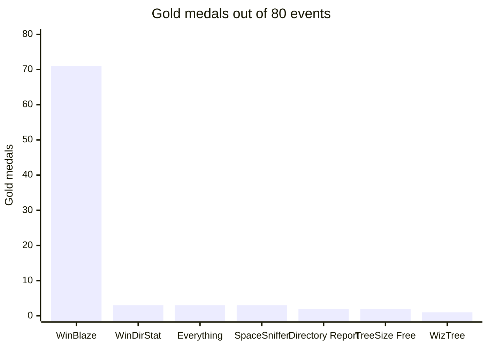
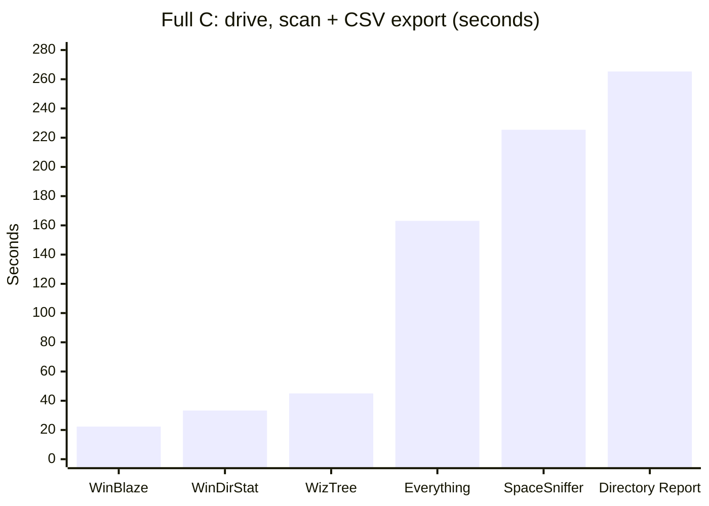
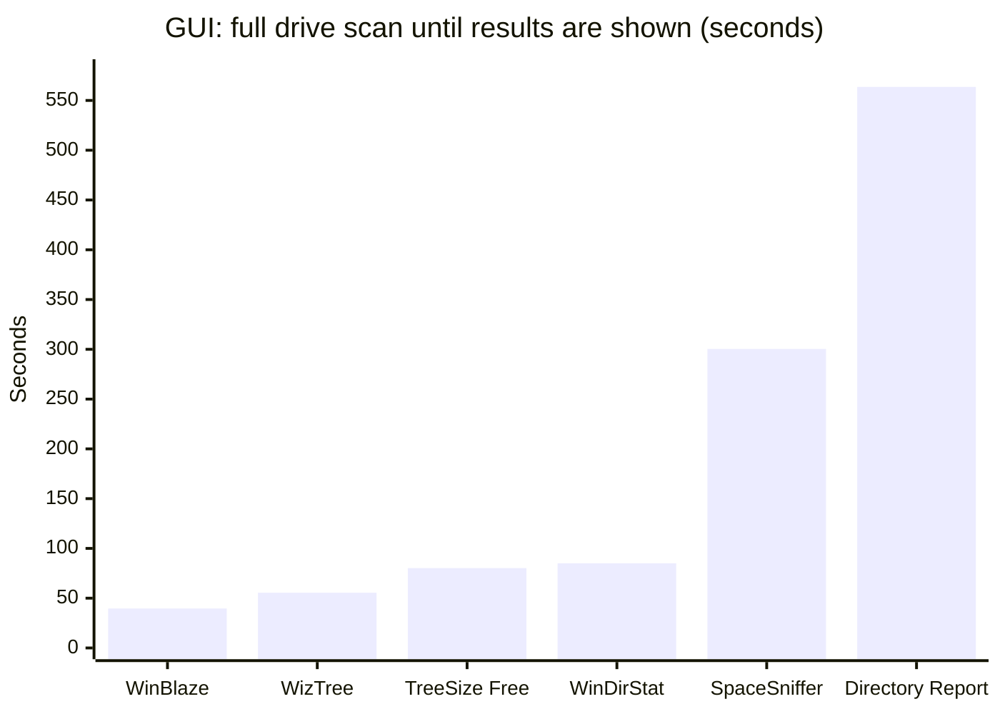
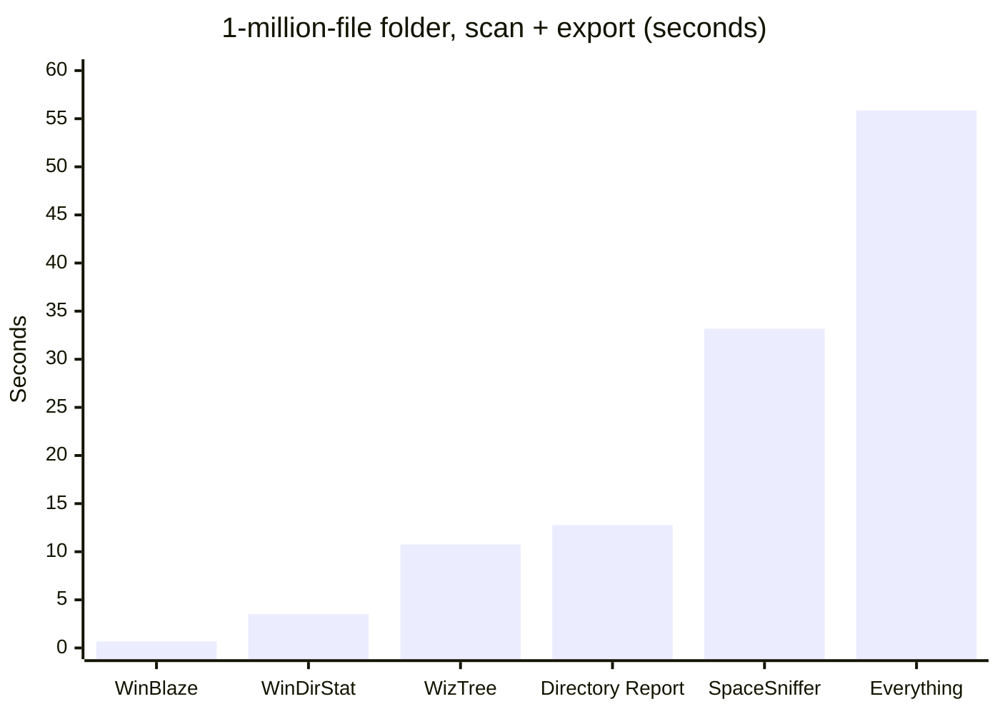
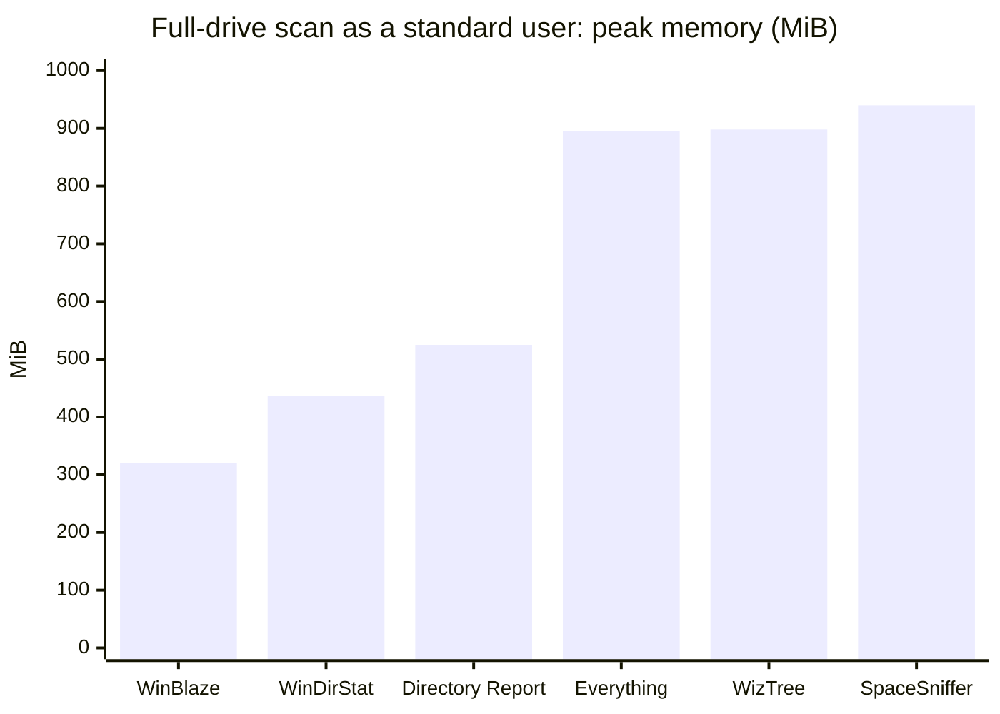
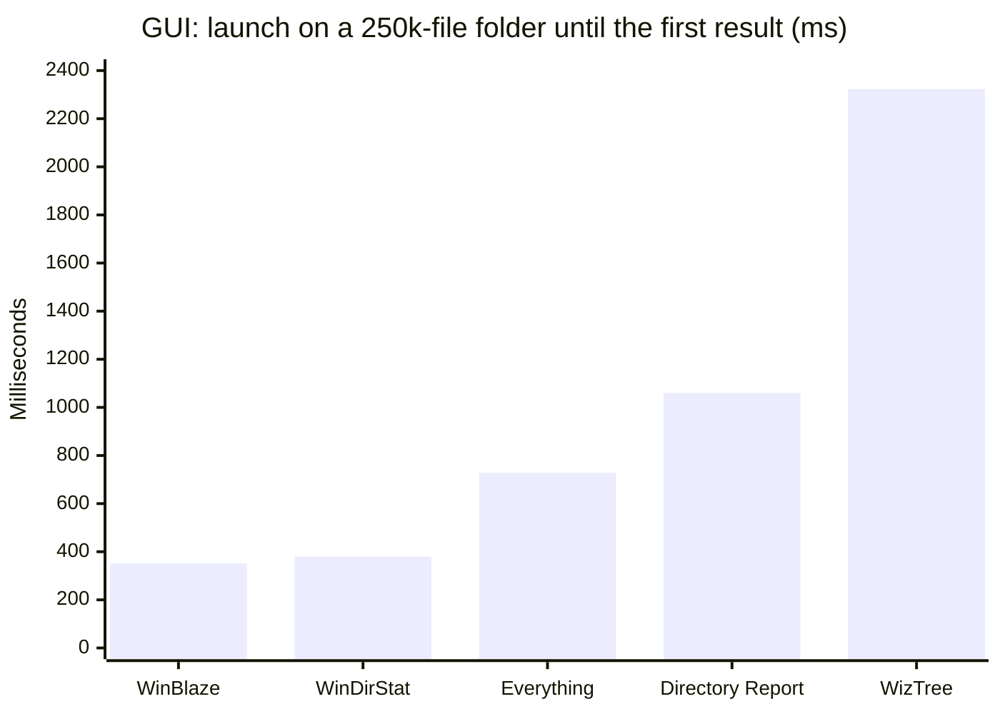
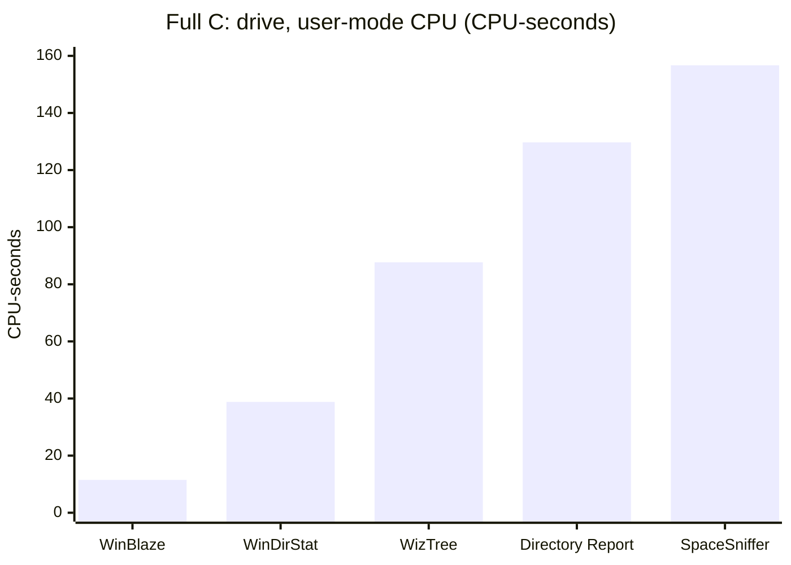

# WinBlaze

<p align="center">
  
</p>

A blazingly fast disk usage analyzer for Windows that leverages NTFS internals for real-time insight into where your space went.

## Overview

WinBlaze combines a Rust scanning engine (raw NTFS MFT access with a parallel directory-walk fallback) with a C++/WinRT WinUI 3 frontend: a live expandable folder tree, a GPU-accelerated squarified treemap colored by extension, and instant search over a persistent index — wrapped in the **High Velocity** design system.

### Key Features

- **Live folder tree**: directories appear in the tree *as the scan discovers them*, with full size rollups landing the moment the scan completes
- **Real NTFS MFT scanning**: raw-volume Master File Table reader (boot-sector geometry, runlist extents, USA fixups) with correct handling of deleted records, named streams, extension records, and hardlinks
- **Hierarchical treemap**: squarified, extension-colored Direct2D tiles with progressive deepening that never stalls the UI thread
- **Persistent indexing**: compact binary snapshots reload instantly; incremental rescans diff against the previous state
- **Memory disciplined**: file paths are derived (not stored) per record — a 2.2M-file index fits in ~1 GB working set and a 323 MB snapshot
- **Responsive by measurement**: the UI ships its own frame/flush latency counters, and scan-time work is budgeted per frame
- **Self-updating**: checks GitHub for a newer release on launch (and on demand), then downloads, **SHA-256-verifies**, and installs the update in-app before relaunching — no manual reinstall

## Benchmark results (October 2026)

WinBlaze was measured against six other Windows disk analyzers across **80 medal events**: scan speed on 23 datasets (from the full `C:\` drive to adversarial fixtures), CPU, memory, I/O, GUI responsiveness, startup and reliability. Each event takes the median of 10 runs, and medals go to the three best values.

### Medal standings

| Product | 🥇 Gold | 🥈 Silver | 🥉 Bronze |
|---|---:|---:|---:|
| **WinBlaze** | **71** | 4 | 3 |
| WinDirStat | 3 | 39 | 20 |
| Everything | 3 | 16 | 7 |
| SpaceSniffer | 3 | 6 | 4 |
| Directory Report | 2 | 9 | 20 |
| TreeSize Free | 2 | 0 | 3 |
| WizTree | 1 | 4 | 22 |



### Headline events

Lower is better in every chart. **WinBlaze is the first bar.**













| Event | WinBlaze | Next best |
|---|---:|---:|
| Full C: drive (3.35M files), scan + CSV export | **22.3 s** | WinDirStat 33.3 s |
| GUI full drive, scan until results are shown | **39.6 s** | WizTree 55.5 s |
| 1-million-file folder | **0.68 s** | WinDirStat 3.52 s |
| Deep long paths | **405 ms** | Everything 445 ms |
| Standard-user full-drive peak memory | **320 MiB** | WinDirStat 436 MiB |
| Standard-user full-drive CPU | **80.1 CPU-s** | Everything 83.2 CPU-s |
| Full C: kernel CPU | **128 CPU-s** | SpaceSniffer 131 CPU-s |
| Full C: disk bytes read | **2.9 KB** | WinDirStat 4.2 KB |
| GUI time to first result | **351 ms** | WinDirStat 380 ms |
| Startup to first idle | **60 ms** | WinDirStat 64 ms |
| Failed scans on hostile datasets | **0 %** | (tied with four others; Everything 20 %) |

### Where WinBlaze does not win

| Event | WinBlaze | Leader | Why |
|---|---:|---:|---|
| GUI · usable-window startup | 160 ms 🥈 | Everything 135 ms | Most of it is the system XAML framework starting up |
| GUI session · reload saved results | 626 ms 🥈 | Everything 178 ms | Everything reopens its own database |
| GUI · refresh after a small change | 246 ms 🥈 | Everything 30 ms | Everything is notified of changes and never rescans |
| Full C: disk bytes written | 517 MiB 🥈 | SpaceSniffer 323 MiB | Almost all of it is the CSV export itself (full paths) |
| Full C: context switches | 327k 🥉 | SpaceSniffer 225k | Kernel file-system work; reducing thread wake-ups did not change it |
| GUI full drive · memory with results | 721 MiB 🥉 | TreeSize Free 520 MiB | Holds the complete 3.35M-file index in memory |
| GUI session · redraw after resize | 66 ms 🥉 | Directory Report 54 ms | XAML relayout. The benchmark samples the screen about every 30 ms, so this is two samples against just under two |
| GUI full drive · responsiveness p95 | 0.64 ms | TreeSize Free 0.15 ms | All products answer within a millisecond |
| GUI · memory growth over 10 rescans | +23 MiB | WinDirStat −0.8 MiB | Not a leak: memory is back to its first-scan level about 1 s after each scan. The benchmark samples 300 ms after the last scan |

### What we found this round

**Improvements (each red/green tested and checked with interleaved before/after runs):**
- **Time to first result: 391 → 351 ms (silver → gold).** A finished scan no longer builds live tree rows that the snapshot reload immediately discards. The post-scan "top 50 of 250k" search selects in a single streaming pass instead of sorting every match (26 → 10.5 ms).
- **Disk bytes read on a full scan: halved, 5,976 → 2,988 bytes (silver → gold).** The allocation-hint file was the only file a report scan read, and it was read twice.
- **Exports:** JSON and full-metadata CSV build each record in one reused buffer: 500k files, 85 → 56 ms and 77 → 52 ms, with byte-identical output.
- **Catalog load:** short names are read without a heap copy, and a 1 MiB read buffer makes a 1M-file catalog load about 17 % faster.
- **MFT parsing:** names decode straight into inline storage, and DOS 8.3 aliases are validated but never decoded.

**Benchmark fairness fixes (applied to every product):**
- The resize benchmark now captures only the window's visible frame and parks the mouse pointer away from the window. Before, a hover highlight under the pointer, or a blinking cursor in a window behind, counted as a late redraw for whichever product was being measured.
- Extended-benchmark timeouts apply equally to every product, and only real timeouts are recorded as failures.
- Install footprint is no longer a medal event: on-disk size isn't performance.

**Bugs found by benchmarking:**
- A code-review fix had silently broken the Release build step that generates the shipping OS XAML host. The benchmark then measured the slower WinUI build: startup memory went 14 → 37 MiB. The fix restores the patched code, and the local gate now validates the host patches (about 1 s), so this cannot ship again.

**Tried and reverted (no measurable gain):** waking one walker thread per new task instead of all of them (no fewer context switches, slower walk); showing the window maximized in one step; rendering the treemap immediately on resize.

### Method

- **Machine:** Windows 11 (build 26300), Intel CPU with 20 logical processors, NVMe `C:` (≈ 488 GB, 3.35 M files), Balanced power plan, warm file cache, screen unlocked.
- **Competitors:** latest releases as of October 2026: WinDirStat 2.9.3, WizTree 4.33, TreeSize Free 4.8.1, Everything 1.4.1, SpaceSniffer 2.2.0, Directory Report 80. Each competitor's best result over all recorded runs is kept, and those bests can only improve.
- **What's measured:** standard-user runs unless an event says Administrator. CLI events time process start to finished CSV, with exact kernel counters. GUI events use window-title, `WM_NULL` and pixel-settle probes.
- **Where:** the harness lives in `benchmarks/`, and generating the datasets is described under [Benchmarking](#benchmarking).

## Project Stats

| | |
|---|---|
| Tracked files | 147 |
| Rust | 10,300 lines across 32 files (5 crates) |
| C++/WinRT | 7,072 lines across 17 files |
| PowerShell automation | 2,768 lines across 28 scripts |
| Documentation | 2,544 lines across 38 markdown files |
| Rust unit/integration tests | 89 (`cargo test`), plus scripted UI smoke, negative smoke, and budgeted benchmarks |

## Installation

### Requirements

- Windows 10 version 1903 or later (Windows 11 recommended)
- x64 architecture
- Administrator privileges for the NTFS MFT fast path (the directory-walk fallback runs unelevated)
- Visual C++ Runtime 2022

### Quick Start

1. Download the latest release from [Releases](https://github.com/marksmayo/WinBlaze/releases)
2. Run the MSI installer or extract the portable ZIP
3. Launch WinBlaze — run as Administrator to enable raw MFT scanning

## Usage

1. The root path defaults to `C:\` — adjust it, then click **Start scan**
2. Watch folders stream into the tree live; sizes fill in at completion
3. Double-click folders to expand them; children load on demand
4. Click treemap tiles to select; colors match the extension legend
5. Use **Incremental rescan** to refresh only what changed

### Reports and file management

The File menu exports complete CSV/JSON scans, filtered CSV, treemap PNG, verified duplicate reports and owner/group/DACL permission reports. **Open CSV scan** reopens WinBlaze, WinDirStat or WizTree exports without rescanning the original disk. **Export raw MFT** requires an administrator session.

Cleanup lists largest files in pages, with confirmed **Move** and **Recycle** actions. Moves never overwrite an existing destination; directory/reparse-point actions are rejected. **File > Monitor file-system changes** enables recursive, debounced automatic refresh for a live scan root. Imported catalogs cannot monitor.

The portable package and installer include the unattended CLI:

```powershell
.\winblaze-cli.exe C:\Data scan.csv
.\winblaze-cli.exe --duplicates C:\Data duplicates.csv
.\winblaze-cli.exe --permissions C:\Data permissions.csv
# Run from an administrator session:
.\winblaze-cli.exe --dump-mft C:\ volume.mft
```

The CLI writes only the requested report. Add `--keep-catalog` before the other arguments (`.\winblaze-cli.exe --keep-catalog C:\Data scan.csv`) to also save the scan as the catalog the GUI reopens.

Duplicate detection compares complete bytes and excludes hard-link aliases from reclaimable copies. ACL reports include errors for inaccessible entries and exclude privileged audit SACLs. Allocation uses actual Windows storage; logical totals retain hard-link names while physical storage is counted once.

Current results are summarized under [Benchmark results](#benchmark-results-october-2026). The benchmark scripts also generate a full per-event dashboard locally (`benchmarks/CURRENT_COMPARISON.html`), with ten repeats per workload, binary and version provenance, and explicit timing scopes.

### Keyboard Shortcuts

| Shortcut | Action |
|----------|--------|
| `Ctrl+F` | Focus search box |
| `Ctrl+4` | Reveal search panel |
| `Ctrl+5` | Reveal diagnostics panel |
| `Escape` | Cancel current scan |

## Technical Architecture

- **src/WinBlaze.Core** — domain models, rollup aggregation, change/lineage detection
- **src/WinBlaze.Scanner** — raw-MFT reader (volume handle, runlist extents, fixups) and parallel directory-walk fallback with reparse-cycle protection
- **src/WinBlaze.Index** — binary snapshot persistence, incremental diffing, search, and the arena tree read model that serves the UI's paged children queries
- **src/WinBlaze.Native** — C ABI bridge: batched scan events, cached index model, paged `wb_tree_*` APIs
- **src/WinBlaze.UI** — C++/WinRT WinUI 3 shell: live tree arena, Direct2D squarified treemap, High Velocity design system

### Performance Design

- Directory events cross the FFI in 4,096-entry batches; UTF-8→UTF-16 conversion happens off the event pipeline
- The read model is published before the UI hears "Completed", so post-scan reloads hit a hot cache
- Treemap paints budget node materialization per frame and refine progressively
- Debug UI builds automatically ship the newest (typically release-profile) native DLL

## Building from Source

### Prerequisites

- Visual Studio 2022 with C++ workload
- Rust toolchain (stable)
- Windows SDK 10.0.22621.0 or later

### Build Steps

```powershell
git clone https://github.com/marksmayo/WinBlaze.git
cd WinBlaze

# Optimized scanner engine (Debug UI builds pick this up automatically)
cargo build --release -p winblaze-native

# UI (Debug)
& "C:\Program Files (x86)\Microsoft Visual Studio\2022\BuildTools\MSBuild\Current\Bin\amd64\MSBuild.exe" `
  src\WinBlaze.UI\WinBlaze.UI.vcxproj /p:Configuration=Debug /p:Platform=x64

# Full local gate: tests, build, UI smoke, packaging
powershell -ExecutionPolicy Bypass -File scripts\check-local.ps1 -Configuration Debug
```

## Benchmarking

```powershell
# Generate test datasets
powershell -ExecutionPolicy Bypass -File benchmarks\make-datasets.ps1 -Size tiny

# Run performance benchmarks
powershell -ExecutionPolicy Bypass -File benchmarks\run-ui-benchmark.ps1 -Size tiny

# Record competitor inventory / manual timings
powershell -ExecutionPolicy Bypass -File benchmarks\record-competitor-baselines.ps1
```

## Privacy

WinBlaze has **no telemetry**. It writes only local files: structured logs at `%LOCALAPPDATA%\WinBlaze\logs` and the scan index at `%LOCALAPPDATA%\WinBlaze\index`. See `docs\PRODUCTION_SECURITY_REVIEW.md`.

## Contributing

See [CONTRIBUTING.md](CONTRIBUTING.md). Run `scripts\check-local.ps1` before submitting changes; performance budgets are enforced.

## License

MIT — see [LICENSE](LICENSE).

## Roadmap

### Done
- ✅ Raw NTFS MFT scanning (elevated) with directory-walk fallback
- ✅ Live expandable folder tree with per-folder rollups
- ✅ Squarified extension-colored GPU treemap
- ✅ Persistent index, instant search, incremental rescan
- ✅ High Velocity design system

### Next
- 🔄 End-to-end record batching through the scan pipeline (WizTree-class times for both backends)
- 🔄 Donut used-space gauge, Explorer file table, and Cleanup center from the design mockups
- 🔄 Duplicate file detection
- 🔄 Export to various formats
